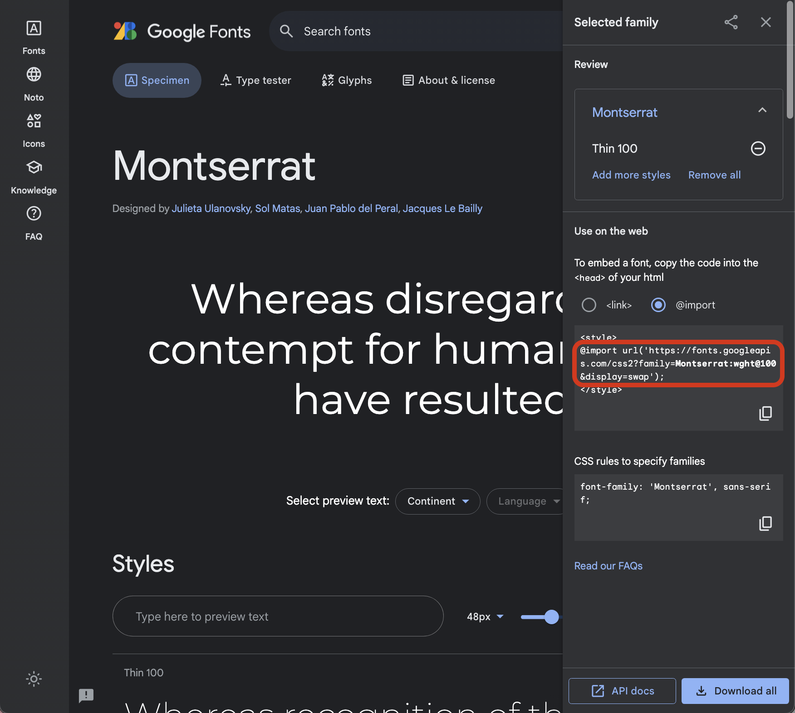

# 

**Learning objective:** Use system fonts and Google fonts to control the appearance of text.

When choosing a font for our projects, we can either use a pre-installed **system font**, or we can import a webfont from a library like **Google Fonts**.

## System fonts

System fonts are a good option to use because they are guaranteed to be available on all users' devices. This means that our website will look the same for everyone, regardless of what operating system or browser they are using.

To use a system font in CSS, we simply need to specify the font name in the [`font-family`](https://developer.mozilla.org/en-US/docs/Web/CSS/font-family) property. For example, to use the system font `Arial`, we would use the following CSS:

```css
body {
  font-family: Arial, sans-serif;
}
```

By specifying a fallback font, such as `sans-serif`, we ensure that our text will still be readable even if the user's device does not have the `Arial` font installed.

Here are sume of the most common system fonts:

  - **Windows**: Arial, Times New Roman, Courier New, Georgia
  - **macOS**: San Francisco, Helvetica Neue, Times New Roman, Courier New
  - **Linux**: Ubuntu, Liberation Sans, Liberation Serif, Courier New

## Google Fonts

[Google Fonts](https://fonts.google.com/) are a great option if we want to use a font that is not pre-installed on the user's device. Google Fonts are free to use and they have a wide variety of fonts to choose from, including serif, sans-serif, display, and handwriting fonts.

We can incorporate a Google Font on our site in two ways: linking through the HTML or importing into our external stylesheet.

Navigate to [https://fonts.google.com/](https://fonts.google.com/) and choose the font(s) you want. 

Once on the page for the specific font you want, select the font variations that appeal to you (if there are multiple).


If a sidebar doesn't automatically open after selecting a font variation, open it by clicking on the **shopping bag** icon in the top right:


Next, choose either the `<link>` or `@import` option (both are fine!):


If you selected `<link>`, copy the entire shaded block and paste it into the `<head>` of your HTML document above your external stylesheet. 

```html
<!DOCTYPE html>
<html>
<head>
  <link rel="preconnect" href="https://fonts.googleapis.com">
  <link rel="preconnect" href="https://fonts.gstatic.com" crossorigin>
  <link href="https://fonts.googleapis.com/css2?family=Montserrat:wght@100&display=swap" rel="stylesheet">
  <!-- external stylesheet below -->
  <link rel="stylesheet" href="/css/style.css">
</head>
```

If you selected `@import`, copy the text between the `<style>` tags and paste it into the top of your `css/style.css` file.



```css
@import url('https://fonts.googleapis.com/css2?family=Montserrat:wght@100&display=swap');

body {
  font-family: Helvetica, Tahoma, Verdana, sans-serif;
}

h1 {
  text-align: center;
}
```

Keep in mind that if you decide to add more Google fonts to your project, you'll need to update the html link or the css import. Google automatically includes all of your selected fonts when generating the import links, regardless of which font you're currently looking at. 
