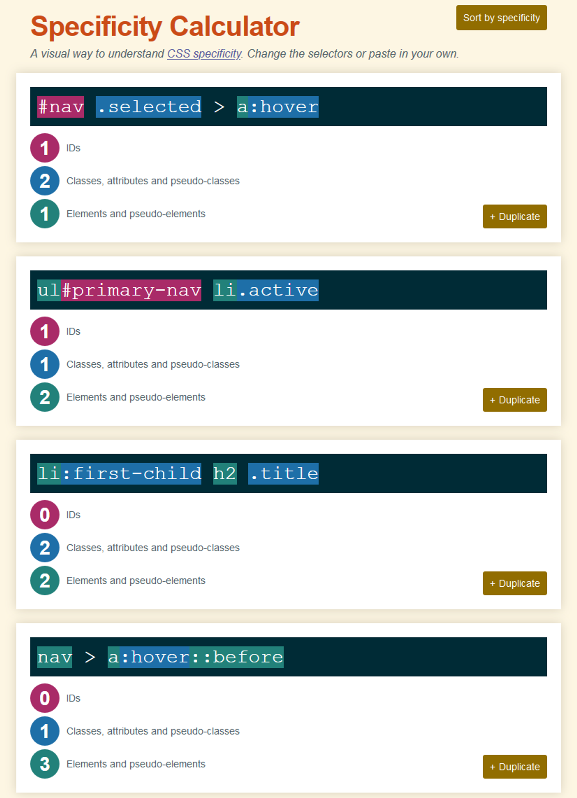

# 

**Learning objective:** By the end of this lesson, students will be able to explain fundamental concepts like inheritance, specificity, and margin collapsing.

## Inheritance

Inheritance is a key component of CSS - It dictates that certain properties such as font color can be passed from parent elements to child elements implicitly. This is cool because it prevents us from writing a bunch of repetitive CSS - but sometimes it may have unintended side effects - like when we were using the **child-selector**.

We are able to override inheritance by giving an `initial` value to keys we don’t want to inherit from parents. For example to get our desired `<li>` behavior:

```css
li {
  margin: 5px 0 0 0;
  color: initial;
}
```

## Specificity

Specificity is another way a browser decides which CSS rule gets applied when there is a conflict. For example:

```css
.my-class {
    color: blue;
}

div {
    color: red;
}

<div class="my-class">What color am I?</div>
```

A conflict exists because the `<div`> matches both CSS selector rules.

The selector with the **highest** *specificity* wins.

The specificity is based upon the following priorities, where *Priority A* has higher specificity:
  - Priority A: inline styling
  - Priority B: IDs
  - Priority C: Classes, attributes, & pseudo-classes
  - Priority D: Elements

Internally, the browser computes a CSS Specificity as shown here (from [https://specificity.keegan.st/](https://specificity.keegan.st/)):



## Margin collapsing

Margin collapsing is a behavior that occurs when the margins of adjacent block-level elements overlap. This can cause the margins to merge together, resulting in a larger margin than expected.

Margin collapsing only occurs between vertically adjacent block-level elements. Inline elements and floated elements do not collapse their margins.

Here are some examples of margin collapsing:

  1. In this example, the margins of the `.box1` and `.box2` elements will collapse, resulting in a single margin between the two elements.
  
  ```html
  <div class="container">
    <div class="box1"></div>
    <div class="box2"></div>
  </div>
  ```

  2. In this example, the margin of the `.box` element will not collapse with the margin of the paragraph element, because the paragraph element is an inline element.
  
  ```html
  <p>This is a paragraph.</p>
  <div class="box"></div>
  ```

  3. In this example, the margin of the `.box1` element will not collapse with the margin of the image, because the image is a floated element.

  ```html
  <div class="container">
    <div class="box1"></div>
    
    <div class="box2"></div>
  </div>
  ```

### How to prevent margin collapsing

There are a few ways to prevent margin collapsing:

- **Add padding**: Adding padding to the parent element will create a space between the parent element and its children, preventing their margins from collapsing.
- **Float the elements**: Floating the elements will prevent their margins from collapsing.
- **Use *flexbox* or *grid*: CSS flexbox and grid layout provide more control over the layout of your elements and can be used to prevent margin collapsing. More on this in a future lesson.
