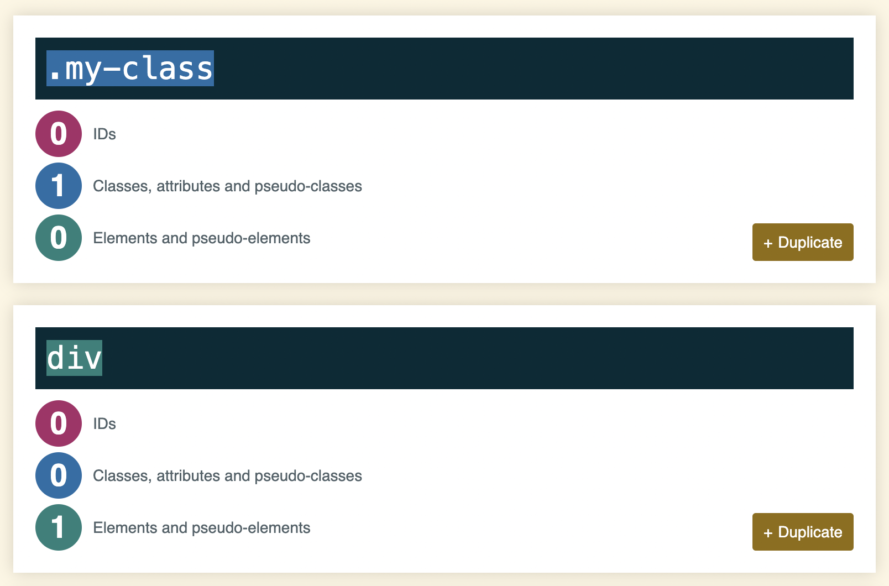

# Specificity

Specificity is a way the browser decides which CSS rule gets applied when there is a conflict. For example:

```css
.my-class {
    color: blue;
}

div {
    color: red;
}

<div class="my-class">What color am I?</div>
```

A conflict exists because the same `<div>` has two css selectors applied with a color. 

The selector with the **highest** *specificity* wins.

Specificity is based upon the following priorities, where *Priority A* has higher specificity:
  - Priority A: inline styling
  - Priority B: IDs
  - Priority C: Classes, attributes, & pseudo-classes
  - Priority D: Elements

So, in the above example, we'd expect the `div` to be blue, as classes take have a higher specificity than elements. 

Internally, the browser computes CSS Specificity as shown below 



source: [https://specificity.keegan.st/](https://specificity.keegan.st/)